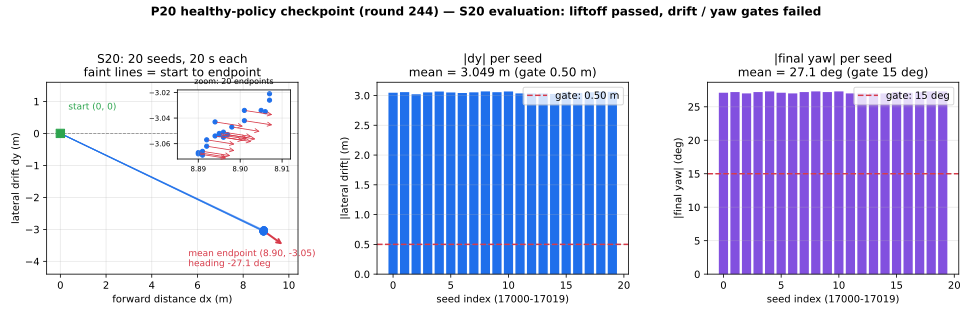

# FT-CPG Reproduction — P20 Checkpoint: S20 Evaluation Evidence

One recorded evaluation from a MuJoCo + Unitree Go2 re-implementation of FT-CPG
(Zhang et al., IEEE Robotics and Automation Letters, 2025). The policy shown is P20,
a student policy fine-tuned with PPO for 244 rounds. Checkpoint: round 244 (frozen).
Evaluation S20: 20 seeds (17000–17019), 20 seconds each, flat ground, constant forward
command 0.5 m/s.

## Result

- **Liftoff gate (S5) PASSED**: all four legs' foot-clearance rates were above threshold
  (pooled clearance 1.00 for FL, FR, RL and RR).
- **S20 FAILED on exactly two gates**: mean |lateral drift| 3.049 m (gate ≤ 0.50 m);
  mean |final yaw| 27.1° (gate ≤ 15°).
- **All other S20 gates passed**: mean forward distance 8.897 m (gate ≥ 6.0 m);
  forward success 20/20; mean steady vx 0.426 m/s (gate ≥ 0.25); falls 0/20;
  joint torque violations 0.

The failure is systematic, not noise: every seed drifted to the same side
(dy −3.02 to −3.07 m) and ended at nearly the same heading (yaw −27.0° to −27.3°).
The policy walks forward without falling but cannot hold lateral position or heading.

## Figure

## Per-seed results (S20, 20 seeds)

| Seed | Forward dx (m) | Lateral dy (m) | Final yaw (deg) | Falls |
|-----:|---:|---:|---:|---:|
| 17000 | 8.898 | -3.047 | -27.1 | 0 |
| 17001 | 8.892 | -3.057 | -27.2 | 0 |
| 17002 | 8.907 | -3.021 | -27.0 | 0 |
| 17003 | 8.895 | -3.052 | -27.2 | 0 |
| 17004 | 8.890 | -3.067 | -27.3 | 0 |
| 17005 | 8.896 | -3.051 | -27.1 | 0 |
| 17006 | 8.901 | -3.042 | -27.0 | 0 |
| 17007 | 8.897 | -3.053 | -27.2 | 0 |
| 17008 | 8.891 | -3.069 | -27.3 | 0 |
| 17009 | 8.896 | -3.055 | -27.2 | 0 |
| 17010 | 8.890 | -3.068 | -27.3 | 0 |
| 17011 | 8.906 | -3.035 | -27.0 | 0 |
| 17012 | 8.901 | -3.034 | -27.0 | 0 |
| 17013 | 8.905 | -3.034 | -27.0 | 0 |
| 17014 | 8.907 | -3.026 | -27.0 | 0 |
| 17015 | 8.895 | -3.053 | -27.2 | 0 |
| 17016 | 8.894 | -3.043 | -27.1 | 0 |
| 17017 | 8.894 | -3.054 | -27.2 | 0 |
| 17018 | 8.891 | -3.066 | -27.3 | 0 |
| 17019 | 8.892 | -3.062 | -27.3 | 0 |

Full per-seed data: [s20_results.csv](s20_results.csv)

## Note

Summary metrics only — no code and no paper draft are included. Values are taken directly
from the project's recorded evaluation file for checkpoint round 244 (S20).
